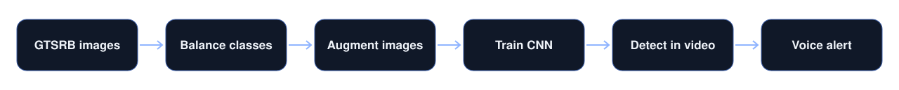
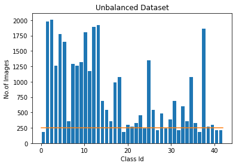
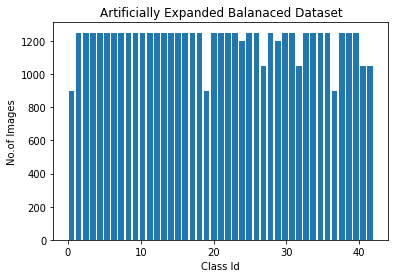
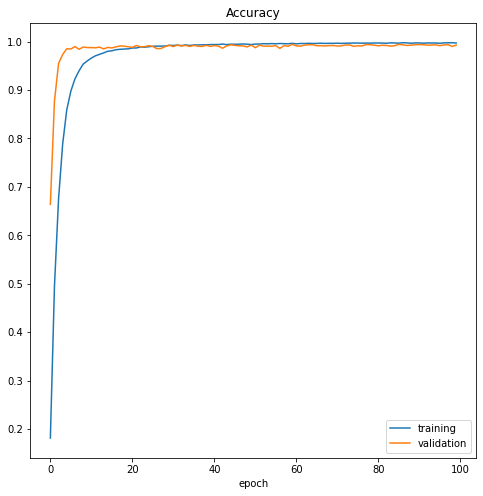
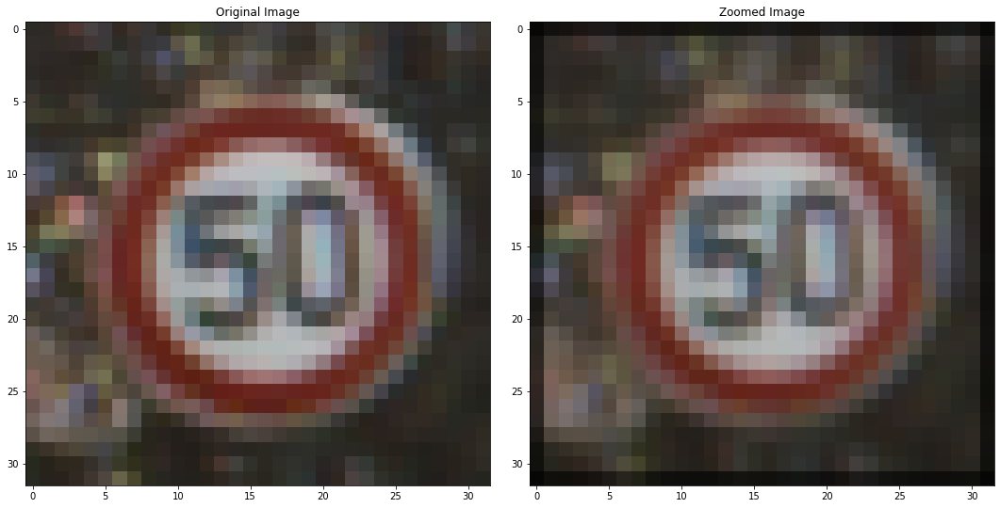
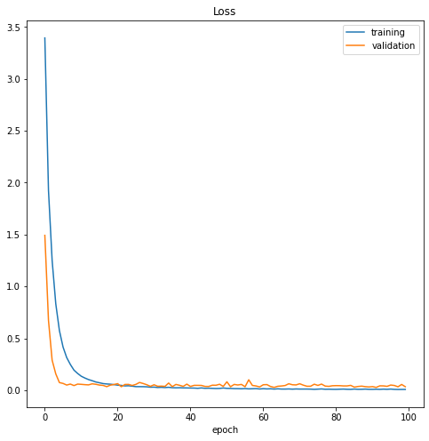

> A traffic sign recognition model that reached 98.8% accuracy on unseen test images across 43 sign types.

**Training project · IoT & Computer Vision track**  
**Tools:** Python, TensorFlow/Keras, OpenCV, YOLOv3, imgaug, pyttsx3

## The challenge

Real traffic sign datasets are heavily unbalanced: common signs have many images and rare signs very few. A model trained directly on that data tends to ignore the rare signs.

## The data

GTSRB, the German Traffic Sign Recognition Benchmark: 34,799 training images and 4,410 validation images in 43 classes, at 32×32 pixels.

## How it works

1. Started from 34,799 training images in 43 classes, with 4,410 for validation.
2. Capped over-represented classes, leaving a balanced base of 10,360 images.
3. Expanded it again with image augmentation, so rare signs were better represented.
4. Trained a convolutional network for 100 epochs, then fine-tuned it twice at lower learning rates.
5. Combined a YOLOv3 detector with the classifier to work on video, and added spoken alerts.

## A closer look

- **Model:** a convolutional network with six convolution layers, batch normalization, and dropout, followed by dense layers.
- **Training:** batch size 32, 100 epochs, then two 10-epoch fine-tuning rounds at much lower learning rates.
- **Live use:** YOLOv3 finds the sign in the frame, the classifier names it, and a voice engine reads it aloud.

## Key decisions

- Balancing came first, because accuracy on an unbalanced set can hide poor results on rare signs.
- Fine-tuning at lower learning rates added a small but measurable gain, from 98.58% to 98.82%.

## Results

| Measure | Result |
|---|---|
| Test accuracy after first training | **98.58%** |
| After first fine-tuning | **98.78%** |
| After second fine-tuning | **98.82%** |
| Classes | **43** |

## Visual results

*Before: the original unbalanced dataset*

*After: the balanced, augmented dataset*

*Accuracy during training*

*Augmentation: an original image and a generated variation*

*Loss during training*

## Programming skills

- Python programming and reusable functions
- Designing CNN architectures in Keras
- Array and image processing with NumPy
- Balancing and augmenting image datasets
- Training, fine-tuning, and evaluating models
- Real-time video processing with OpenCV
- Combining a detector, a classifier, and text-to-speech in one pipeline

## Good to know

- Accuracy was measured on the classifier alone. Detection in live video was not measured with a separate score.

## What I would do next

- Measure detection quality on labelled video.
- Report accuracy per sign type, to expose the hardest classes.

<strong>بالعربي: التعرف على إشارات المرور</strong>

نموذج يتعرف على 43 نوعًا من إشارات المرور بدقة 98.8% على صور لم يرها من قبل. عالجتُ اختلال عدد الصور بين الأنواع بالموازنة ثم بتوليد صور إضافية، ودرّبتُ شبكة عصبية، ثم ربطتها بكاشف YOLOv3 للفيديو مع تنبيه صوتي.

**ملاحظة:** الدقة مقاسة للمصنف وحده، ولا توجد درجة منفصلة للكشف في الفيديو.

**المهارات البرمجية:** Python programming and reusable functions، Designing CNN architectures in Keras، Array and image processing with NumPy، Balancing and augmenting image datasets، Training, fine-tuning, and evaluating models، Real-time video processing with OpenCV، Combining a detector, a classifier, and text-to-speech in one pipeline.

الكود خاص، وهذه الصفحة تعرض فكرة المشروع وطريقة عمله ونتائجه.

---

**About the source code:** the code for this project is private. This page presents what it does, how it works, and its results. To talk about the work, contact me through my [GitHub profile](https://github.com/SamerAlTaki97).
